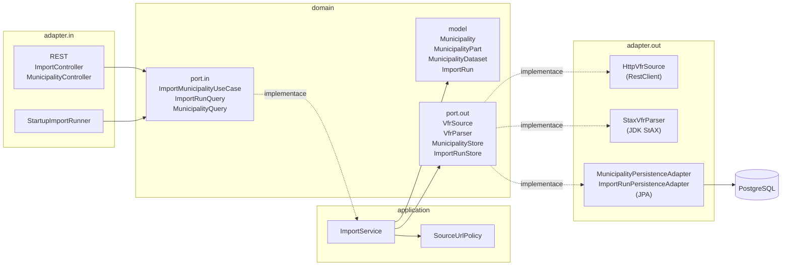

# ruian-importer

[](https://github.com/vojtahubner/ruian-importer/actions/workflows/ci.yml)

Služba, která stáhne výměnný formát RÚIAN (VFR XML) jedné obce, streamově z něj vyčte obec a její části, uloží je do
PostgreSQL a vystaví přes REST API. Je to řešení testovací úlohy Trixi „Zpracuj XML a ulož“ (zadání je v
[docs/zadani.md](docs/zadani.md)): zazipované XML obce Kopidlno z dané URL, parsování standardním nástrojem, tabulky
obec a část obce, Spring a Docker.

## Požadavky

Projekt jde spustit dvěma cestami:

| Cesta | Co je potřeba | K čemu |
| --- | --- | --- |
| Jen Docker | Docker Engine s Compose v2 (Docker Desktop stačí) | `docker compose --profile app up --build`: build i běh aplikace a databáze probíhá v kontejnerech, na hostiteli není potřeba JDK ani Maven. |
| Vývojářská | JDK 25 a Docker | `./mvnw spring-boot:run` (Spring Boot Docker Compose support spustí službu `db` z `compose.yaml`) a `./mvnw verify` (integrační testy běží na Testcontainers). Samotné `./mvnw test` Docker nepotřebuje. |

Jediný podporovaný vstupní bod buildu je Maven Wrapper `./mvnw` (verzi Mavenu si stáhne sám). Systémový `mvn` může běžet
na jiném JDK a není s projektem testovaný.

## Rychlý start

```bash
docker compose --profile app up --build
```

První build trvá 3–5 minut (stahuje se image s JDK a závislosti Mavenu; další buildy berou z cache vše, co se
nezměnilo). Po startu aplikace proběhne import automaticky (`ruian.import.on-startup=true`): stáhne se
`kopidlno.xml.zip`, zparsuje a obec s jejími částmi se uloží.

Ověření z druhého terminálu:

```bash
curl -s localhost:8080/api/municipalities
```

```json
[{"code":573060,"name":"Kopidlno"}]
```

```bash
curl -s localhost:8080/api/municipalities/573060/parts
```

```json
[
  {"code":31801,"name":"Drahoraz","municipalityCode":573060},
  {"code":31828,"name":"Pševes","municipalityCode":573060},
  {"code":69299,"name":"Kopidlno","municipalityCode":573060},
  {"code":69302,"name":"Ledkov","municipalityCode":573060},
  {"code":97373,"name":"Mlýnec","municipalityCode":573060}
]
```

(Odpověď je ve skutečnosti na jednom řádku, zde zalomená pro čitelnost.) Totéž přímo v databázi:

```bash
docker compose exec db psql -U ruian -d ruian -c "select code, name, municipality_code from municipality_part order by name"
```

```text
 code  |   name   | municipality_code
-------+----------+-------------------
 31801 | Drahoraz |            573060
 69299 | Kopidlno |            573060
 69302 | Ledkov   |            573060
 97373 | Mlýnec   |            573060
 31828 | Pševes   |            573060
(5 rows)
```

A záznam o proběhlém importu (časy budou samozřejmě jiné):

```bash
curl -s localhost:8080/api/imports
```

```json
[{"id":1,"sourceUrl":"https://www.smartform.cz/download/kopidlno.xml.zip","status":"SUCCEEDED","startedAt":"2026-10-23T08:00:01.234567Z","finishedAt":"2026-10-23T08:00:02.345678Z","municipalityCode":573060,"partCount":5,"errorMessage":null}]
```

Vývojářská cesta (JDK 25 na hostiteli):

```bash
./mvnw spring-boot:run   # Boot sám spustí službu db z compose.yaml, aplikace běží na hostiteli na portu 8080
./mvnw test              # unit testy, bez Dockeru
./mvnw verify            # vše včetně integračních testů na Testcontainers, JaCoCo report v target/site/jacoco/index.html
```

## Splnění zadání

| Bod zadání | Kde v projektu |
| --- | --- |
| Stažení ZIP z URL | `HttpVfrSource` streamuje tělo odpovědi přes `RestClient`; výchozí adresa je v `ruian.import.default-source-url`; po startu import spouští `StartupImportRunner` |
| Parsování standardním nástrojem | StAX z JDK (`javax.xml.stream`) ve `StaxVfrParser`: čte jen `vf:Obec` a `vf:CastObce` a po konci sekce `vf:CastiObci` přestane |
| Tabulky obec a část obce | Flyway migrace `V1__municipality.sql`: `municipality` = obec (kód, název), `municipality_part` = část obce (kód, název, kód obce) |
| Naplnění tabulek | `MunicipalityPersistenceAdapter.replace`: upsert obce a jejích částí v jedné transakci, části chybějící ve zdroji smaže |
| Spring a/nebo Docker | obojí: Spring Boot 4.1, `Dockerfile` a `compose.yaml` |
| Nad rámec zadání | historie běhů importu (tabulka `import_run`), REST API nad uloženými daty, import libovolné obce zadáním URL v `POST /api/imports` |

## API

| Metoda | Cesta | Popis | Odpovědi |
| --- | --- | --- | --- |
| `POST` | `/api/imports` | Spustí import. Tělo `{"sourceUrl": "..."}` je nepovinné, bez něj se použije výchozí zdroj. Import je synchronní, odpověď přijde po jeho dokončení. | `201` + `Location: /api/imports/{id}` a záznam běhu; `400` nečitelné tělo, příliš dlouhá nebo neplatná URI; `422` zdroj mimo allowlist nebo neplatné VFR; `502` zdroj nedostupný; `500` neočekávaná chyba |
| `GET` | `/api/imports?limit=20` | Poslední běhy, nejnovější první; `limit` 1–100, výchozí 20 | `200`; `400` limit mimo rozsah |
| `GET` | `/api/imports/{id}` | Detail jednoho běhu | `200`; `404` |
| `GET` | `/api/municipalities` | Uložené obce seřazené podle kódu | `200` |
| `GET` | `/api/municipalities/{code}` | Obec podle kódu RÚIAN | `200`; `404` |
| `GET` | `/api/municipalities/{code}/parts` | Části obce seřazené podle kódu | `200`; `404` neznámá obec |

- Swagger UI: <http://localhost:8080/swagger-ui.html>, OpenAPI dokument: `/v3/api-docs`
- Actuator: `/actuator/health` (včetně stavu databáze), `/actuator/info`, `/actuator/metrics`
- Postman: [docs/postman/ruian-importer.postman_collection.json](docs/postman/ruian-importer.postman_collection.json)
  (proměnná `baseUrl`)

Import jiné obce z VDP (Veřejný dálkový přístup k RÚIAN):

```bash
curl -s -X POST localhost:8080/api/imports -H 'Content-Type: application/json' -d '{"sourceUrl":"https://vdp.cuzk.gov.cz/vymenny_format/soucasna/20260930_OB_573060_UZSZ.xml.zip"}'
```

VDP drží jen několik posledních měsíčních snímků; `YYYYMMDD` v názvu souboru je poslední den předchozího měsíce.
Prošlý soubor VDP nevrací jako chybu, ale jako HTML stránku, kterou importer odmítne jako neplatné VFR (`422`).

Chyby mají formát RFC 9457 (`application/problem+json`) s typy `urn:problem-type:source-not-allowed` (422),
`urn:problem-type:invalid-vfr` (422), `urn:problem-type:source-unavailable` (502), `urn:problem-type:import-failed`
(500), `urn:problem-type:not-found` (404) a `urn:problem-type:internal-error` (500). Když import selže až po kontrole
zdroje, je běh zaznamenaný jako `FAILED` a problém na něj ukazuje (`instance` a `importRunId`). Příklad pro zdroj
mimo allowlist, kdy se žádný běh nezakládá:

```json
{
  "type": "urn:problem-type:source-not-allowed",
  "title": "Source not allowed",
  "status": 422,
  "detail": "Source https://example.com/x.zip is not allowed: host example.com is not on the allowlist",
  "instance": "/api/imports"
}
```

## Kde začít číst

1. [`StaxVfrParser`](src/main/java/cz/vojtechhubner/ruian/adapter/out/xml/StaxVfrParser.java) – jádro úlohy: rozpozná
   ZIP, StAX kurzorem vyčte obec a její části a po sekci `vf:CastiObci` přestane číst.
2. [`ImportService`](src/main/java/cz/vojtechhubner/ruian/application/ImportService.java) – use case importu: kontrola
   zdroje, stažení, parsování, uložení a záznam běhu včetně toho, co se stane při selhání.
3. [`MunicipalityPersistenceAdapter`](src/main/java/cz/vojtechhubner/ruian/adapter/out/persistence/MunicipalityPersistenceAdapter.java)
   – jediný zapisující kód nad obcemi: advisory lock, upsert a mazání chybějících částí v jedné transakci.
4. [`V1__municipality.sql`](src/main/resources/db/migration/V1__municipality.sql) – obě tabulky ze zadání tak, jak je
   Flyway založí.
5. [`ImportFlowIT`](src/test/java/cz/vojtechhubner/ruian/ImportFlowIT.java) – celý tok od `POST /api/imports` po
   řádky v PostgreSQL nad skutečným souborem Kopidlna.

## Architektura

Kód je rozdělený hexagonálně (Ports & Adapters): `domain` je čistá Java (model, výjimky a porty), `application`
obsahuje use casy a politiku zdrojů, `adapter.in` jsou vstupy (REST, import při startu), `adapter.out` výstupy (HTTP,
StAX, JPA) a `config` jen konfigurační třídy Springu. Závislosti míří dovnitř k doméně a hlídá je `ArchitectureTest`
(ArchUnit). Podrobněji v [docs/architecture.md](docs/architecture.md).



## Design patterny

| Pattern | Kde | Jaký problém tu řeší |
| --- | --- | --- |
| Ports & Adapters (hexagonální architektura) | `domain.port.in`, `domain.port.out`, `application`, `adapter.in.*`, `adapter.out.*`; pravidla hlídá `ArchitectureTest` | Doména a use casy nezávisí na Springu, JPA ani HTTP: `ImportService` se testuje s falešným zdrojem a mocky úložišť, bez databáze a sítě. |
| Adapter | `HttpVfrSource` (`RestClient` → `VfrSource`), `StaxVfrParser` (StAX → `VfrParser`), `MunicipalityPersistenceAdapter` a `ImportRunPersistenceAdapter` (JPA → `MunicipalityStore`, `ImportRunStore`) | Překlad API knihovny na port domény včetně výjimek: HTTP status, `XMLStreamException` nebo `IOException` se ven dostanou jen jako doménové výjimky. |
| Repository za portem | `MunicipalityStore` a `ImportRunStore` nad Spring Data repozitáři (`MunicipalityJpaRepository`, `MunicipalityPartJpaRepository`, `ImportRunJpaRepository`), převod v `PersistenceMapper` | Entity JPA nikdy neopustí adapter; aplikace dostává nezměnitelné recordy a nemůže omylem měnit spravované entity mimo transakci. |
| Application service s oddělenými vstupními porty pro zápis a čtení | `ImportService` implementuje `ImportMunicipalityUseCase` (zápis) i `ImportRunQuery` (čtení), `MunicipalityQueryService` implementuje `MunicipalityQuery` | Controller závisí jen na rozhraní, které potřebuje; v `@WebMvcTest` se mockuje jeden port, ne celá služba. |
| Execute-around (`VfrSource.read`) | `VfrSource.read(URI, Reader<T>)`, implementace v `HttpVfrSource` | Stream HTTP odpovědi žije jen uvnitř callbacku: zavření, překlad I/O chyb i to, že se nic nebufferuje, je na jednom místě a volající nemůže stream nechat otevřený. |
| Policy + value objects | `SourceUrlPolicy`, `ImportProperties`, recordy `Municipality`, `MunicipalityPart`, `MunicipalityDataset`, `ImportRun` | Pravidla pro zdrojovou URL jsou na jednom místě s vlastním testem; neplatný stav (část cizí obce, `FAILED` běh bez zprávy) nejde ani sestavit, hlídají ho kompaktní konstruktory. |

Konvence napříč kódem: konstruktorová injekce do `final` polí, statické factory metody (`ImportRun.succeeded`,
`ImportRunResponse.from`), DTO oddělená od domény s ručním mapperem, immutabilita (recordy, `List.copyOf`) a
fail-fast validace v kompaktních konstruktorech.

## Technologie

- Java 25 a Spring Boot 4.1.2 (Spring Framework 7, Jackson 3): `RestClient`, `ProblemDetail`,
  `@ConfigurationProperties` na recordu.
- PostgreSQL 18 a Flyway: schéma vzniká migracemi `V1__municipality.sql` a `V2__import_run.sql`, Hibernate ho při
  startu jen validuje (`spring.jpa.hibernate.ddl-auto=validate`).
- JDK StAX (`javax.xml.stream`): žádná další XML knihovna, streamování s konstantní pamětí.
- Testcontainers 2 (`testcontainers-postgresql`, `@ServiceConnection`) pro integrační testy.
- Bez Lomboku a MapStructu: recordy a ruční mappery (`PersistenceMapper`, `ImportRunResponse.from` a spol.).
- JSpecify `@NullMarked` na každém balíčku, `@Nullable` jen tam, kde je `null` legitimní hodnota.
- springdoc-openapi: Swagger UI a OpenAPI dokument generované z controllerů.
- Docker: multi-stage `Dockerfile` (Temurin 25 JDK pro build, JRE Alpine pro běh), vrstvený jar
  (`java -Djarmode=tools -jar application.jar extract --layers`), neprivilegovaný uživatel, `HEALTHCHECK` na
  `/actuator/health`.
- GitHub Actions (job `verify` s `./mvnw verify` a job `docker` s buildem image) a Dependabot (Maven, GitHub Actions
  a Docker, týdně).

## Testování

Unit testy (`*Test`, Maven Surefire, bez Dockeru) běží v `./mvnw test`; integrační testy (`*IT`, Maven Failsafe)
potřebují Docker kvůli Testcontainers a běží v `./mvnw verify`. V CI na commitu `52bb32b` proběhlo 142 unit a 22
integračních testů (`ImportFlowIT` 7, `PersistenceAdaptersIT` 11, `JpaMappingIT` 4).

| Test | Co pokrývá |
| --- | --- |
| `MunicipalityTest` | record obce: kladný kód, neprázdný název, 48 znaků projde a delší ne |
| `MunicipalityPartTest` | record části obce: kladný kód části i kód obce, neprázdný název, 48 znaků projde a delší ne |
| `MunicipalityDatasetTest` | dataset obce: defenzivní kopie seznamu částí, část cizí obce odmítne s jejím kódem ve zprávě, počet částí |
| `ImportRunTest` | record běhu: factory `succeeded` a `failed`, `withId`, konzistence `SUCCEEDED`/`FAILED` s kódem obce, počtem částí a chybovou zprávou, konec ne před začátkem, `null` v povinných polích, zkrácení chybové zprávy |
| `SourceNotAllowedExceptionTest` | zpráva výjimky pojmenuje zdroj a důvod odmítnutí |
| `SourceUnavailableExceptionTest` | zpráva pojmenuje zdroj a důvod, původní výjimka zůstává jako příčina |
| `ImportFailedExceptionTest` | zpráva pojmenuje id běhu a příčinu, `SUCCEEDED` běh odmítne |
| `NotFoundExceptionTest` | zpráva pojmenuje hledaný zdroj a jeho id |
| `ImportServiceTest` | use case importu s Mockito: výchozí vs. zadaný zdroj, policy před vším ostatním, záznam `FAILED` běhu při selhání, skrytí detailů neočekávané chyby |
| `MunicipalityQueryServiceTest` | seznam obcí, obec a její části přicházejí z `MunicipalityStore`, neznámá obec je `NotFoundException` |
| `SourceUrlPolicyTest` | pravidla allowlistu parametrizovaně: `https` na povoleném hostu nebo jeho subdoméně (i s portem 443 a velkými písmeny) projde; relativní URL, `http`, user info, jiný port, IP adresa a cizí host se odmítnou s důvodem ve zprávě |
| `ImportPropertiesTest` | binding `ruian.import.*` přes `ApplicationContextRunner`, `64MB` jako `DataSize`, prázdný `allowed-hosts` zastaví start |
| `ErrorMessagesTest` | sanitizace chybových zpráv: zpráva `ImportException` projde (bez zprávy její typ), ostatní výjimky se nahradí názvem typu |
| `ImportControllerTest` (`@WebMvcTest`) | `POST /api/imports` bez těla, s prázdným i zadaným `sourceUrl`, 201 s `Location`, 400 pro neplatnou nebo dlouhou URI, 422 pro zdroj mimo allowlist bez běhu, 422/502/500 pro selhaný běh jako ProblemDetail s `instance` a `importRunId`, 500 bez textu příčiny; `GET` seznam s `limit` (výchozí 20, 400 mimo rozsah) a detail běhu včetně 404 |
| `MunicipalityControllerTest` (`@WebMvcTest`) | seznam obcí, obec a její části podle kódu, 404 pro neznámou obec, 500 bez textu výjimky |
| `ImportRunResponseTest` | mapování běhu na DTO, odmítnutí běhu bez id |
| `StartupImportRunnerTest` | import při startu proběhne jednou a žádné selhání nepoloží aplikaci |
| `HttpVfrSourceTest` (`@RestClientTest` + `MockRestServiceServer`) | streamování těla do readeru, 404/500/3xx jako nedostupný zdroj, propagace parsovací chyby, přerušený stream, timeout |
| `StaxVfrParserTest` | plain i zazipované XML, přeskočení cizích položek archivu, archiv bez XML, žádná nebo více obcí, část cizí obce, XXE se nerozvine, zastavení po částech obce, limit velikosti, poškozené XML, výpadky přenosu |
| `StaxVfrParserRealFileTest` | skutečný `kopidlno.xml.zip`: obec 573060 s pěti částmi a méně než 200 kB přečtených z archivu |
| `BoundedInputStreamTest` | limit rozbalených bajtů: přesně limit projde, bajt navíc i čtení pole přes limit selže, přeskočené bajty (`skip`) se počítají |
| `PersistenceMapperTest` | převod entit obce a části na recordy a běhu `SUCCEEDED`/`FAILED` mezi recordem a entitou oběma směry |
| `OpenApiConfigTest` | název, popis a verze API z build info, bez něj verze `dev` |
| `ArchitectureTest` (ArchUnit) | pravidla architektury, viz níže |
| `MutableClockTest` | testovací hodiny stojí na počátečním okamžiku v UTC, `advance` a `setInstant` je posunou, `withZone` zachová okamžik |
| `TestClockConfigurationTest` | `MutableClock` jako `@Primary` vedle aplikačního `Clock` je ten, který se injektuje |
| `JpaMappingIT` (`@DataJpaTest`) | Flyway tabulky existují a Hibernate validace projde, audit časy z aplikačních hodin, kaskádové mazání částí, round trip `import_run` |
| `PersistenceAdaptersIT` (`@DataJpaTest`) | `replace` nad skutečným PostgreSQL: založení, změna jen změněných řádků, smazání chybějících částí, přesun části mezi obcemi, nezávislost obcí; ukládání a řazení běhů |
| `ImportFlowIT` (`@SpringBootTest`) | celý tok přes HTTP: import Kopidlna a čtení přes API, idempotence druhého importu, nedostupný zdroj jako `FAILED` běh s 502, zdroj mimo allowlist bez běhu, health s databází, OpenAPI |

Pravidla v `ArchitectureTest`: `domain` závisí jen na `java.*` a JSpecify; `application` nezávisí na `adapter` ani
`config`; adaptery nezávisí na sobě navzájem; `config` nezávisí na adapterech; JPA a Hibernate zůstávají v
`adapter.out.persistence`; v `application` není `@Transactional`; veřejné metody `*PersistenceAdapter` jsou
`@Transactional`; mezi balíčky nejsou cykly; `@RestController` jen v `adapter.in.web`.

Pokrytí měří JaCoCo nad oběma fázemi dohromady (`config`, `dto` a hlavní třída jsou z měření vyloučené) a
`./mvnw verify` selže pod 70 % řádků. Na commitu `52bb32b` naměřilo CI 97,9 % řádků a 92,2 % větví; report je v CI
artefaktu `reports` a lokálně po `./mvnw verify` v `target/site/jacoco/index.html`.

Parser čte jen začátek souboru: rozbalené XML Kopidlna má 13 411 844 bajtů, sekce `vf:CastiObci` končí na bajtu
10 440 a tam `StaxVfrParser` skončí. Z 526 kB archivu tak přečte zhruba 2 kB komprimovaných dat;
`StaxVfrParserRealFileTest` to hlídá limitem 200 kB.

## Konfigurace

| Vlastnost | Výchozí hodnota | Význam |
| --- | --- | --- |
| `ruian.import.default-source-url` | `https://www.smartform.cz/download/kopidlno.xml.zip` | zdroj pro import při startu a pro `POST /api/imports` bez `sourceUrl` |
| `ruian.import.allowed-hosts` | `smartform.cz`, `vdp.cuzk.gov.cz` | hosty (a jejich subdomény), ze kterých se smí stahovat; jen `https` na portu 443 |
| `ruian.import.on-startup` | `true` | spustit import výchozího zdroje po startu aplikace (`StartupImportRunner`) |
| `ruian.import.max-uncompressed-bytes` | `64MB` | nejvíc rozbaleného XML, které parser z jednoho zdroje přečte (`BoundedInputStream`) |
| `spring.http.clients.connect-timeout` | `5s` | timeout navázání spojení při stahování |
| `spring.http.clients.read-timeout` | `60s` | timeout čtení odpovědi; import je synchronní, takže zároveň omezuje dobu požadavku |
| `spring.http.clients.redirects` | `dont-follow` | přesměrování se nenásledují, 3xx je nedostupný zdroj (allowlist se kontroluje jen na zadané URL) |

Profily: `docker` (aktivní v image přes `SPRING_PROFILES_ACTIVE`) vypíná Docker Compose support a zapíná
strukturované logování ECS; `test` (integrační testy) vypíná Docker Compose support a import při startu.

## Rozhodnutí

- [ADR 0001 – Hexagonální architektura](docs/adr/0001-hexagonalni-architektura.md)
- [ADR 0002 – StAX streaming a early exit](docs/adr/0002-stax-streaming-a-early-exit.md)
- [ADR 0003 – Synchronní import, historie běhů a synchronizace částí](docs/adr/0003-synchronni-import-historie-behu-a-synchronizace-casti.md)
- [ADR 0004 – Allowlist zdrojů a SSRF](docs/adr/0004-allowlist-zdroju-a-ssrf.md)

## Limity a co dál

- Historie běhů nezná stav `RUNNING` a import je synchronní: `POST /api/imports` vrátí 201 až po dokončení, žádné
  202 Accepted s dotazováním na průběh. Pro pomalé zdroje by se běh zakládal předem jako `RUNNING` a import spouštěl
  asynchronně.
- Bez stránkování: `GET /api/imports` má jen `limit` (nejvýš 100), seznamy obcí a částí stránkování nemají. Pro
  jednu obec to stačí, pro celostátní data ne.
- Bez metrik a událostí: Actuator vystavuje jen standardní metriky, počet a trvání importů ani aplikační události se
  nepublikují.
- Bez autentizace na `POST /api/imports`: import spustí kdokoli, kdo se dostane k portu. Přidala by se přes Spring
  Security (HTTP Basic pro interní nasazení, nebo JWT jako resource server), `POST` jen pro roli importéra, `GET`
  veřejné.
- Jedna obec na import: soubor s více obcemi (celostátní `ST_*` z VDP) parser odmítne jako neplatné VFR (422).
- DNS rebinding není řešen: ochrana proti SSRF je allowlist hostů, `dont-follow` a `InetAddressFilter`, který se
  vyhodnocuje jednou na požadavek. Kdo ovládá DNS allowlistovaného hosta, může odpověď změnit mezi kontrolou a
  spojením.
- Datum dat z hlavičky VFR (`vf:Hlavicka`) se neukládá; `import_run` zná čas běhu, ne stáří snímku.
- Chybí test nad statutárním městem (Brno): jeho VFR obsahuje městské obvody a části (`vf:Momc`), které parser
  ignoruje. Stálo by za to ověřit, že se obec a její části přečtou stejně.
- Rychlejší start kontejneru: CDS archiv (tréninkový běh při buildu image) a AOT zpracování kontextu by start zkrátily
  z několika sekund.

## Licence

[MIT](LICENSE)
