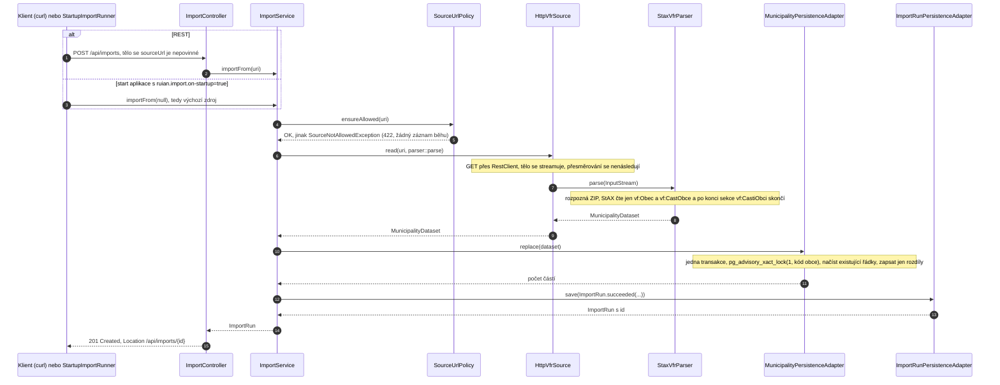
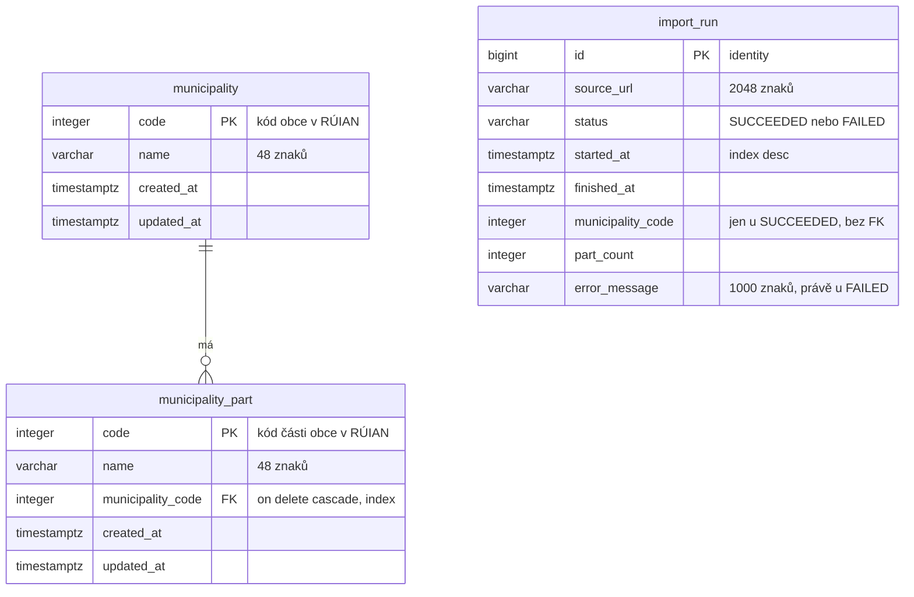

# Architektura

## Přehled

Aplikace je rozdělená hexagonálně (Ports & Adapters). Uprostřed je `domain`: nezměnitelný model, doménové výjimky a
porty, tedy rozhraní, přes která se do hexagonu vstupuje (`port.in`) a kterými hexagon mluví se světem (`port.out`).
`application` implementuje vstupní porty a používá výstupní; adaptery pak porty napojují na konkrétní technologii:
REST a start aplikace dovnitř, HTTP, StAX a JPA ven.

Proč pro úlohu této velikosti: use case importu (`ImportService`) se dá otestovat bez databáze, sítě i Springu, každý
adapter jde vyměnit nebo testovat samostatně (`HttpVfrSource` s `MockRestServiceServer`, persistence s Testcontainers)
a závislosti mezi vrstvami nejsou konvence, ale pravidla, která hlídá `ArchitectureTest`. Daň jsou porty, mappery a
DTO navíc; zdůvodnění je v [ADR 0001](adr/0001-hexagonalni-architektura.md).

## Vrstvy a balíčky

```text
cz.vojtechhubner.ruian
├── RuianImporterApplication       vstupní bod (@SpringBootApplication, @ConfigurationPropertiesScan)
├── domain                         čistá Java a JSpecify, žádný Spring, JPA ani XML
│   ├── model                      Municipality, MunicipalityPart, MunicipalityDataset, ImportRun, ImportStatus
│   ├── exception                  ImportException a potomci (SourceNotAllowed, SourceUnavailable, VfrParse,
│   │                              ImportFailed), NotFoundException
│   └── port
│       ├── in                     ImportMunicipalityUseCase, ImportRunQuery, MunicipalityQuery
│       └── out                    VfrSource, VfrParser, MunicipalityStore, ImportRunStore
├── application                    ImportService, MunicipalityQueryService, SourceUrlPolicy, ImportProperties,
│                                  ErrorMessages
├── adapter
│   ├── in
│   │   ├── web                    ImportController, MunicipalityController, ApiExceptionHandler, dto/*
│   │   └── startup                StartupImportRunner (ApplicationRunner, jen při ruian.import.on-startup=true)
│   └── out
│       ├── http                   HttpVfrSource (RestClient z auto-konfigurovaného builderu)
│       ├── xml                    StaxVfrParser, BoundedInputStream, VfrNamespaces
│       └── persistence            MunicipalityPersistenceAdapter, ImportRunPersistenceAdapter, PersistenceMapper,
│                                  entity/*, repository/*
└── config                         ClockConfig, HttpClientConfig, JpaConfig, OpenApiConfig
```

Pravidla závislostí (vynucená `ArchitectureTest`): `domain` závisí jen na `java.*` a `org.jspecify`; `application`
nezná `adapter` ani `config`; adaptery nezávisí na sobě navzájem (`StaxVfrParser` bere limit z `ImportProperties`,
což je `application`, nikoli jiný adapter); JPA a Hibernate smí importovat jen `adapter.out.persistence`;
`@Transactional` se v `application` nevyskytuje; mezi balíčky nejsou cykly. Každý balíček má `package-info.java`
s `@NullMarked`.

## Tok importu



`StartupImportRunner` volá use case přímo, bez controlleru, a jakékoli selhání jen zaloguje: start API nesmí záviset
na dostupnosti zdroje. Neočekávané výjimky (ne `ImportException`) se do záznamu běhu dostanou jen jako název typu
(`ErrorMessages.sanitize`); SQL, cesty a hosty zůstávají v logu serveru.

## Datový model



Schéma zakládá Flyway (`V1__municipality.sql`, `V2__import_run.sql`), Hibernate ho při startu jen validuje
(`ddl-auto=validate`), takže rozdíl mezi entitami a migrací zastaví aplikaci. `created_at` a `updated_at` plní Spring
Data auditing z aplikačního `Clock` (`JpaConfig`), proto jsou v testech deterministické. `import_run` úmyslně nemá
cizí klíč na obec: neúspěšný běh žádnou obec nemá. Databázová podmínka `(status = 'FAILED') = (error_message is not
null)` kopíruje invariant recordu `ImportRun`.

## Transakční hranice

- V `application` není žádná transakce; transakce vlastní výstupní persistence adaptery (`@Transactional` na zápisech,
  `@Transactional(readOnly = true)` na čteních). `spring.jpa.open-in-view` je vypnuté.
- `MunicipalityPersistenceAdapter.replace()` je jediná zapisující transakce nad daty obce: advisory lock, upsert obce,
  upsert částí a smazání chybějících částí buď projdou celé, nebo se nic nezmění.
- `ImportRunPersistenceAdapter.save()` zapisuje běh jednou, v samostatné transakci, až když je výsledek známý. Když
  `replace()` selže a odrolluje, `FAILED` běh se přesto uloží; API tak nikdy neukáže napůl zapsanou obec a přitom o
  selhání ví. Záznam `SUCCEEDED` se zapisuje až po datové transakci a mimo ošetření selhání: když se řádek historie
  nepodaří zapsat, skončí požadavek obyčejnou 500 bez `FAILED` záznamu.
- Stahování a parsování probíhá mimo transakci: spojení do databáze se drží jen po dobu zápisu, ne po dobu downloadu.

## Chybové stavy

| Výjimka | Kde vzniká | HTTP | `type` |
| --- | --- | --- | --- |
| `SourceNotAllowedException` | `SourceUrlPolicy`, před stažením; žádný běh se nezakládá | 422 | `urn:problem-type:source-not-allowed` |
| `ImportFailedException` s příčinou `SourceUnavailableException` | `HttpVfrSource`: HTTP jiné než 2xx včetně 3xx, timeout, DNS, adresa hosta blokovaná `InetAddressFilter`, přerušený stream | 502 | `urn:problem-type:source-unavailable` |
| `ImportFailedException` s příčinou `VfrParseException` | `StaxVfrParser`, `BoundedInputStream`: poškozený ZIP nebo XML, žádná nebo více obcí, část cizí obce, překročený limit | 422 | `urn:problem-type:invalid-vfr` |
| `ImportFailedException` s jinou příčinou | cokoli dalšího po kontrole zdroje, typicky databáze | 500 | `urn:problem-type:import-failed` |
| `NotFoundException` | `MunicipalityQueryService`, `ImportService.byId` | 404 | `urn:problem-type:not-found` |
| validace parametrů, nečitelné tělo, `ResponseStatusException` | `ImportController` a Spring MVC (`ResponseEntityExceptionHandler`) | 400 | výchozí `about:blank` |
| jakákoli jiná výjimka | `ApiExceptionHandler.handleUnexpected`, zaloguje se, text výjimky se neposílá | 500 | `urn:problem-type:internal-error` |

U `ImportFailedException` ukazuje `instance` na zaznamenaný běh (`/api/imports/{id}`) a problém nese i `importRunId`.
Detail obsahuje jen zprávu doménové výjimky; zpráva neočekávané příčiny se ven nedostane.

## Bezpečnost

- Zdroj importu musí projít `SourceUrlPolicy`: absolutní `https` URL bez user info, port 443 a host z
  `ruian.import.allowed-hosts` nebo jeho subdoména.
- Přesměrování se nenásledují (`spring.http.clients.redirects=dont-follow`): allowlist se vyhodnocuje na zadané URL a
  redirect by ho obešel. 3xx se hlásí jako nedostupný zdroj.
- `InetAddressFilter.externalAddresses()` (`HttpClientConfig`) nechá auto-konfigurované HTTP klienty odmítnout
  loopback, privátní a jiné neveřejné adresy; je to obrana do hloubky za allowlistem, vyhodnocená jednou na
  požadavek. Podrobnosti a limity v [ADR 0004](adr/0004-allowlist-zdroju-a-ssrf.md).
- XXE: `StaxVfrParser` má vypnuté DTD i externí entity (`SUPPORT_DTD`, `IS_SUPPORTING_EXTERNAL_ENTITIES`).
- Limit velikosti: `BoundedInputStream` počítá rozbalené bajty a nad `ruian.import.max-uncompressed-bytes` (64 MB)
  parsování ukončí, takže ZIP bomba neroztáhne paměť ani disk; nic se navíc nebufferuje.
- Chybové zprávy: do `import_run` a do API jde jen zpráva doménové výjimky, ostatní výjimky se redukují na název typu.
- Kontejner běží pod neprivilegovaným uživatelem, `/actuator/health` zobrazuje detaily vždy (ukázkové nastavení, v
  produkci by bylo `when-authorized` za autentizací).

## Souběh

Import téže obce může běžet současně z více míst (start aplikace a `POST /api/imports`, dvě instance služby).
`replace()` proto bere transakční advisory lock `pg_advisory_xact_lock(1, kód obce)`: druhý import téže obce počká,
až první commitne, a pak pracuje nad jeho výsledkem (load-then-diff, takže nic nezaloží podruhé). Importy různých
obcí se neblokují. Zámek drží PostgreSQL, funguje tedy napříč instancemi a uvolní se sám při commitu i rollbacku.
Záznam běhu se do zámku nevejde úmyslně: zapisuje se až po něm, v samostatné transakci.

## Testovací strategie

| Úroveň | Kontext | Testy |
| --- | --- | --- |
| Čisté unit testy | žádný Spring; Mockito pro porty | `domain.*`, `ImportServiceTest`, `MunicipalityQueryServiceTest`, `SourceUrlPolicyTest`, `ErrorMessagesTest`, `PersistenceMapperTest`, `StaxVfrParserTest`, `StaxVfrParserRealFileTest`, `BoundedInputStreamTest`, `StartupImportRunnerTest`, `ImportRunResponseTest`, `OpenApiConfigTest` |
| Spring slice | `@WebMvcTest` s `@MockitoBean` porty; `@RestClientTest(HttpVfrSource.class)` s `MockRestServiceServer`; `ApplicationContextRunner` pro binding properties | `ImportControllerTest`, `MunicipalityControllerTest`, `HttpVfrSourceTest`, `ImportPropertiesTest` |
| Architektura | ArchUnit nad `target/classes` | `ArchitectureTest` |
| Integrační (`*IT`) | `@DataJpaTest` s `@Import(TestcontainersConfiguration, JpaConfig, TestClockConfiguration, adaptery)`; `@SpringBootTest(RANDOM_PORT)` s `@AutoConfigureMockRestServiceServer` a `@AutoConfigureRestTestClient`; profil `test` | `JpaMappingIT`, `PersistenceAdaptersIT`, `ImportFlowIT` |

`TestcontainersConfiguration` poskytuje `PostgreSQLContainer` (`postgres:18-alpine`) přes `@ServiceConnection`;
kontejner startuje jednou na každý cachovaný Spring kontext. Profil `test` vypíná Docker Compose support a import při
startu, takže integrační testy nikdy nesahají na internet. `TestClockConfiguration` dává `@Primary` `MutableClock`,
díky němuž jsou audit časy a časy běhů v testech předvídatelné. `ImportFlowIT` nahrazuje zdroj mock HTTP serverem,
který vrací skutečný `kopidlno.xml.zip` ze `src/test/resources/vfr`.
